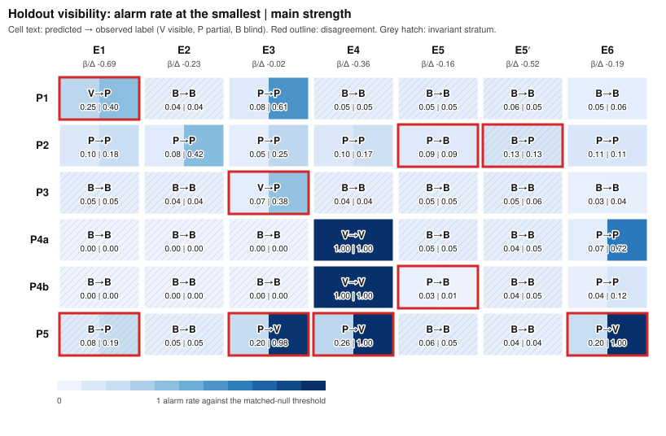

# Visibility boundary and failure causes, protocol v4 (Task 4-1)

Evidence type: noisy simulation (holdout split 20, read once; Proposition-1
splits 30/31). Labels and endpoints are confirmatory or secondary as
registered; the cause classification and the P1b comparison are exploratory
interpretations. Generated by `experiments/synthesis/boundary_synthesis_v4.py`
from committed results only.

## Figure

**Figure 1. Only readout probes on readout structures and the symmetry probe on
symmetry-breaking structures reach visibility; most cells stay blind as
predicted, and the failures concentrate in the budget-sensitive stratum.**
Each cell shows the holdout alarm rate against the matched-null threshold at
the smallest frozen strength (left half) and the main strength (right half),
the predicted and observed label, and a red outline where they disagree.
Column headers give the median beta/Delta of the main point over the 100
holdout graphs.

## 1. Summary

- Primary endpoint: improvement, dFC +0.0080 [+0.0029, +0.0142], coverage loss 0.418.
- Visibility agreement: invariant 0.913, sensitive 0.632 (never pooled).
- Development and holdout labels coincide in 40 of 42 cells.
- Proposition-1 hit rate 45/100 (ties 47).
- Cell disagreements by cause: design 1, method 1, model 3, resources 4.

Cause rules (applied mechanically):

- **design**: a protocol choice made before data (calibration sample, degenerate threshold, endpoint definition) produces the outcome.
- **method**: the probe statistic or decision rule behaves differently from its derivation at finite shots.
- **resources**: the population contrast exists but the fixed budget gives power below the label threshold.
- **model**: the derivation's effect-size assessment was wrong in the conservative direction (more power than predicted).

## 2. All 42 cells

| Cell | Stratum | Predicted | Development | Holdout | Smallest strength | Power | False alarm | Cause | Evidence |
|---|---|---|---|---|---|---:|---:|---|---|
| P1/E1 | sensitive | visible | partial | partial **(disagrees)** | partial | 0.400 | 0.058 | resources | power 0.400 is above 0.10 but below 0.80 at n_P = 1,638 |
| P1/E2 | invariant | blind | blind | blind | blind | 0.038 | 0.039 | - | - |
| P1/E3 | sensitive | partial | partial | partial | blind | 0.613 | 0.061 | - | - |
| P1/E4 | invariant | blind | blind | blind | blind | 0.048 | 0.045 | - | - |
| P1/E5 | invariant | blind | blind | blind | blind | 0.049 | 0.055 | - | - |
| P1/E5' | invariant | blind | blind | blind | blind | 0.054 | 0.052 | - | - |
| P1/E6 | sensitive | blind | blind | blind | blind | 0.056 | 0.047 | - | - |
| P2/E1 | sensitive | partial | partial | partial | partial | 0.183 | 0.053 | - | - |
| P2/E2 | sensitive | partial | partial | partial | blind | 0.416 | 0.049 | - | - |
| P2/E3 | sensitive | partial | partial | partial | blind | 0.247 | 0.049 | - | - |
| P2/E4 | sensitive | partial | partial | partial | blind | 0.170 | 0.059 | - | - |
| P2/E5 | sensitive | partial | blind | blind **(disagrees)** | blind | 0.086 | 0.092 | resources | power 0.086 does not exceed 0.10: the contrast is below what the budget can detect |
| P2/E5' | invariant | blind | blind | partial **(disagrees)** | partial | 0.132 | 0.133 | design | power 0.132 equals the matched-null alarm rate 0.133: the statistic does not respond; the label comes from a null alarm rate above alpha against development thresholds calibrated on two graphs per stratum |
| P2/E6 | sensitive | partial | blind | partial | partial | 0.113 | 0.113 | - | - |
| P3/E1 | invariant | blind | blind | blind | blind | 0.046 | 0.051 | - | - |
| P3/E2 | invariant | blind | blind | blind | blind | 0.037 | 0.051 | - | - |
| P3/E3 | sensitive | visible | partial | partial **(disagrees)** | blind | 0.379 | 0.052 | resources | power 0.379 is above 0.10 but below 0.80 at n_P = 1,638 |
| P3/E4 | invariant | blind | blind | blind | blind | 0.043 | 0.049 | - | - |
| P3/E5 | invariant | blind | blind | blind | blind | 0.048 | 0.041 | - | - |
| P3/E5' | invariant | blind | blind | blind | blind | 0.060 | 0.053 | - | - |
| P3/E6 | sensitive | blind | blind | blind | blind | 0.038 | 0.037 | - | - |
| P4a/E1 | invariant | blind | blind | blind | blind | 0.000 | 0.000 | - | - |
| P4a/E2 | invariant | blind | blind | blind | blind | 0.000 | 0.000 | - | - |
| P4a/E3 | invariant | blind | blind | blind | blind | 0.000 | 0.000 | - | - |
| P4a/E4 | sensitive | visible | visible | visible | visible | 1.000 | 0.000 | - | - |
| P4a/E5 | invariant | blind | blind | blind | blind | 0.049 | 0.044 | - | - |
| P4a/E5' | invariant | blind | blind | blind | blind | 0.055 | 0.042 | - | - |
| P4a/E6 | sensitive | partial | partial | partial | blind | 0.715 | 0.047 | - | - |
| P4b/E1 | invariant | blind | blind | blind | blind | 0.000 | 0.000 | - | - |
| P4b/E2 | invariant | blind | blind | blind | blind | 0.000 | 0.000 | - | - |
| P4b/E3 | invariant | blind | blind | blind | blind | 0.000 | 0.000 | - | - |
| P4b/E4 | sensitive | visible | visible | visible | visible | 1.000 | 0.000 | - | - |
| P4b/E5 | sensitive | partial | blind | blind **(disagrees)** | blind | 0.010 | 0.048 | resources | power 0.010 does not exceed 0.10: the contrast is below what the budget can detect |
| P4b/E5' | invariant | blind | blind | blind | blind | 0.052 | 0.037 | - | - |
| P4b/E6 | sensitive | partial | partial | partial | blind | 0.119 | 0.039 | - | - |
| P5/E1 | invariant | blind | partial | partial **(disagrees)** | blind | 0.187 | 0.053 | method | power 0.187 versus null 0.053: the population statistic is invariant but its finite-shot distribution is not (pre-lock investigation for P5/E1) |
| P5/E2 | invariant | blind | blind | blind | blind | 0.052 | 0.064 | - | - |
| P5/E3 | sensitive | partial | visible | visible **(disagrees)** | partial | 0.982 | 0.048 | model | power 0.982 reaches 0.80 with false alarm 0.048: the derivation underestimated the effect |
| P5/E4 | sensitive | partial | visible | visible **(disagrees)** | partial | 1.000 | 0.048 | model | power 1.000 reaches 0.80 with false alarm 0.048: the derivation underestimated the effect |
| P5/E5 | invariant | blind | blind | blind | blind | 0.054 | 0.058 | - | - |
| P5/E5' | invariant | blind | blind | blind | blind | 0.040 | 0.040 | - | - |
| P5/E6 | sensitive | partial | visible | visible **(disagrees)** | partial | 1.000 | 0.052 | model | power 1.000 reaches 0.80 with false alarm 0.052: the derivation underestimated the effect |

## 3. Decision-level failures

| Item | Cause | Evidence |
|---|---|---|
| R1 coverage under E4, E5, E5', E6 | design | P4a's clean-E0 threshold is 0 (degenerate null); any readout flip alarms, so C(R1) = 0 (secondary endpoint) |
| R1 coverage under E1 | method | C(R1) 0.015 versus C(R0) 0.298; P1 alarms on most non-flipped graphs and only 0.065 on flipped ones |
| Readout certificate unresolved | resources | P4b spreads n_P over 4*C(w,2) circuits; simultaneous intervals retain channels whose bound exceeds L_T (secondary endpoint) |
| f* not evaluable | design | no development thresholds at f = 0.05 or 0.25 |
| Proposition-1 directional misses (8) | method | all in unresolved_anchor graphs, where the rule defaults to Raw without certification |
| Proposition-1 ties counted as misses (47) | design | registered hit definition; 42 graphs had zero errors for both methods |

## 4. beta/Delta by structure (holdout reference, exact probabilities)

| Structure | Point | Median beta/Delta | Flipped graphs |
|---|---|---:|---:|
| E1 | main | -0.6879 | 13 |
| E1 | sensitivity | -0.0692 | 1 |
| E2 | main | -0.2286 | 20 |
| E2 | sensitivity | +0.0018 | 3 |
| E3 | main | -0.0229 | 8 |
| E3 | sensitivity | -0.0010 | 2 |
| E4 | main | -0.3600 | 0 |
| E4 | sensitivity | -0.0591 | 0 |
| E5 | main | -0.1600 | 1 |
| E5 | sensitivity | -0.1570 | 1 |
| E5' | main | -0.5250 | 10 |
| E5' | sensitivity | -0.5250 | 10 |
| E6 | main | -0.1900 | 0 |
| E6 | sensitivity | -0.1900 | 0 |

## 5. Exploratory: P1b and GVS

P1b (negative quasi-probability weight from P1 counts), alarm rate at the main point against an
in-sample 95th-percentile threshold from the holdout matched-null rows per stratum:

| Structure | P1b power (exploratory, in-sample threshold) | P1 power (registered) |
|---|---:|---:|
| E1 | 0.060 | 0.400 |
| E2 | 0.061 | 0.038 |
| E3 | 0.764 | 0.613 |
| E4 | 0.001 | 0.048 |
| E5 | 0.041 | 0.049 |
| E5' | 0.032 | 0.054 |
| E6 | 0.035 | 0.056 |

GVS was not implemented (`src/probes.py` raises `NotImplementedError`: its
L_C and K definitions were never frozen). This follows the registered scope-cut
order, in which GVS is cut first. It is reported as not run.
